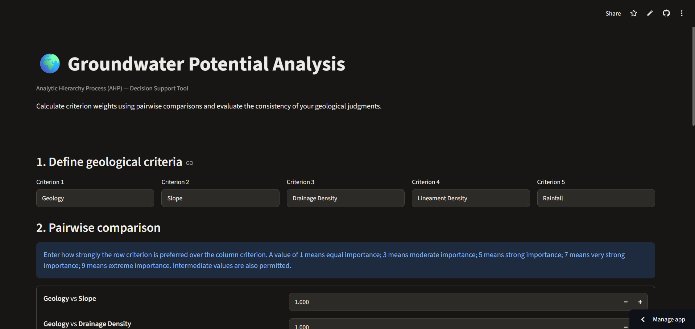

# Groundwater GIS Toolkit

An open-source Python GIS toolkit for **Groundwater Potential Index (GWPI) calculation, Analytical Hierarchy Process (AHP), weighted overlay analysis, and groundwater potential zonation**.

The project demonstrates a reproducible geospatial workflow for identifying groundwater potential zones using thematic raster layers and multi-criteria decision analysis.

## Dashboard Preview



## Groundwater Potential Zonation Map


## Project Overview

Groundwater potential zonation is an important application of Remote Sensing (RS), Geographic Information Systems (GIS), and Multi-Criteria Decision Analysis (MCDA).

This toolkit provides a Python-based workflow to:

- Calculate AHP weights from pairwise comparison matrices.
- Evaluate the consistency of expert judgments.
- Perform weighted overlay analysis on thematic raster datasets.
- Generate a Groundwater Potential Index (GWPI).
- Classify groundwater potential into five zones.
- Visualize and summarize the resulting zonation.
- Explore AHP results through an interactive Streamlit dashboard.

## Live Application

**Try the interactive dashboard:**

[Groundwater GIS Toolkit – Streamlit App](https://groundwater-gis-toolkit.streamlit.app)

## Features

### 1. Analytical Hierarchy Process (AHP)

- Pairwise comparison matrix.
- Normalized priority weights.
- Principal eigenvalue calculation.
- Consistency Index (CI).
- Consistency Ratio (CR).
- Consistency validation using the conventional CR threshold of 0.10.

### 2. Weighted Overlay Analysis

- Raster-based weighted overlay.
- GWPI calculation.
- Handling of raster NoData cells.
- Geospatial metadata preservation.

### 3. Groundwater Potential Zonation

Five groundwater potential classes:

1. Very Low
2. Low
3. Moderate
4. High
5. Very High

### 4. Interactive Dashboard

- Enter and modify pairwise comparison values.
- Calculate AHP weights.
- View consistency results.
- Visualize criterion weights.
- Export calculated results as CSV.

### 5. Geospatial Processing

- GeoTIFF raster input and output.
- Coordinate Reference System preservation.
- Raster resolution preservation.
- Spatial analysis using Rasterio and NumPy.

## Methodology

The toolkit follows a standard MCDA-based groundwater potential zonation workflow.

1. Prepare thematic raster layers.
2. Construct the AHP pairwise comparison matrix.
3. Calculate normalized criterion weights.
4. Evaluate the consistency ratio.
5. Reclassify thematic layers into suitability scores.
6. Apply weighted overlay analysis.
7. Calculate the Groundwater Potential Index.
8. Classify the GWPI into five potential zones.
9. Generate maps and zonal statistics.

### Groundwater Potential Index

The weighted overlay model is expressed as:

**GWPI = Σ (Wi × Ri)**

Where:

- **GWPI** = Groundwater Potential Index
- **Wi** = Weight assigned to the ith thematic criterion
- **Ri** = Suitability score of the ith thematic raster layer

### AHP Consistency

The Consistency Index is calculated as:

**CI = (λmax − n) / (n − 1)**

The Consistency Ratio is:

**CR = CI / RI**

Where:

- λmax = Maximum eigenvalue
- n = Number of criteria
- RI = Random Index

A consistency ratio below 0.10 is conventionally considered acceptable.

## Technology Stack

| Technology | Application |
|---|---|
| Python | Core programming |
| NumPy | Numerical computation |
| Pandas | Data processing |
| SciPy | Scientific computation |
| GeoPandas | Geospatial data processing |
| Rasterio | Raster processing |
| PyProj | Coordinate reference systems |
| Matplotlib | Map visualization |
| Plotly | Interactive charts |
| Streamlit | Web dashboard |
| Pytest | Unit testing |

## Project Structure

```text
Groundwater-GIS-Toolkit/
│
├── app.py
├── generate_demo.py
├── run_demo.py
├── visualize_results.py
├── requirements.txt
├── pytest.ini
├── README.md
│
├── src/
│   ├── __init__.py
│   ├── ahp.py
│   └── overlay.py
│
├── tests/
│   ├── test_ahp.py
│   └── test_overlay.py
│
├── data/
│   └── demo/
│
├── outputs/
│   ├── groundwater_potential_index.tif
│   ├── groundwater_potential_zones.tif
│   ├── groundwater_potential_map.png
│   └── groundwater_zone_statistics.csv
│
└── docs/
    └── images/
        └── dashboard.png
```

## Installation

### 1. Clone the repository

```bash
git clone https://github.com/helldeepak116-design/Groundwater-GIS-Toolkit.git

cd Groundwater-GIS-Toolkit
```

### 2. Create a virtual environment

```bash
python -m venv .venv
```

Activate it on Windows:

```powershell
.venv\Scripts\Activate.ps1
```

### 3. Install dependencies

```bash
pip install -r requirements.txt
```

## Run the Project

### Generate synthetic demo data

```bash
python generate_demo.py
```

### Perform weighted overlay analysis

```bash
python run_demo.py
```

### Generate maps and statistics

```bash
python visualize_results.py
```

### Launch the interactive dashboard

```bash
streamlit run app.py
```

## Demo Dataset and Results

The repository includes a reproducible synthetic dataset generated using a fixed random seed.

| Parameter | Value |
|---|---|
| Raster dimensions | 100 × 100 pixels |
| Pixel resolution | 30 m |
| Coordinate Reference System | EPSG:32645 |
| Valid raster cells | 10,000 |
| Total demonstration area | 900 hectares |
| Number of potential zones | 5 |

### Groundwater Potential Zone Statistics

| Potential Zone | Area (ha) | Area (%) |
|---|---:|---:|
| Very Low | 1.08 | 0.12 |
| Low | 109.26 | 12.14 |
| Moderate | 327.96 | 36.44 |
| High | 392.94 | 43.66 |
| Very High | 68.76 | 7.64 |
| **Total** | **900.00** | **100.00** |

These statistics are generated from the synthetic demonstration dataset and are intended to demonstrate the workflow, not represent actual groundwater conditions.

## Testing

The project includes automated unit tests for AHP calculations and weighted overlay analysis.

Run the test suite:

```bash
pytest -v
```

**Current test status:** 20 tests passing.

## Applications

Potential applications of this toolkit include:

- Groundwater potential zonation.
- Watershed-scale hydrogeological studies.
- Remote Sensing and GIS research.
- MCDA-based environmental analysis.
- Academic research and geospatial modelling.
- Reproducible groundwater assessment workflows.

## Limitations and Disclaimer

This repository uses synthetic demonstration raster data. The generated groundwater potential map and statistics are not validated groundwater observations and must not be interpreted as a real-world groundwater assessment.

For practical applications, users must provide appropriate study-area-specific thematic datasets, scientifically justified suitability scores, and validated AHP judgments.

The results are dependent on input data quality, criterion selection, reclassification schemes, and assigned weights.

## Future Improvements

- Integration with real-world satellite and geological datasets.
- Support for additional thematic criteria.
- Improved raster preprocessing and reclassification tools.
- Groundwater potential validation using well inventory data.
- Advanced geospatial visualization.
- Expanded analytical and statistical tools.

## Author

**Deepak Mohanta**

M.Tech Applied Geology  
National Institute of Technology (NIT), Raipur

**Research Interests:** Remote Sensing & GIS, Hydrogeology, Mineral Exploration, Geospatial Modelling, and Environmental Geoscience.

GitHub: [@helldeepak116-design](https://github.com/helldeepak116-design)

## License

This project is open-source. A license file should be added to the repository before reuse or redistribution under a specified license.