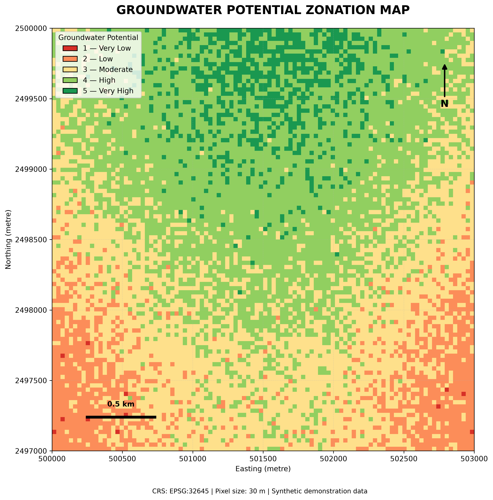

# Groundwater GIS Toolkit

A Python-based geospatial toolkit for **Groundwater Potential Zone (GWPZ) mapping** using the Analytical Hierarchy Process (AHP) and weighted overlay analysis.

The project provides an end-to-end workflow for generating groundwater potential index (GWPI) rasters, classifying groundwater potential zones, visualizing spatial results, and calculating area statistics.

> **Data disclaimer:** This repository currently uses reproducible synthetic raster datasets for demonstration and software testing. The outputs do not represent validated groundwater potential results from an actual watershed.

## Project Preview



*Groundwater potential zonation generated using synthetic demonstration data.*

## Key Features

- AHP-based criteria weighting using the eigenvector method.
- Consistency Index (CI) and Consistency Ratio (CR) calculation.
- Saaty Random Index table for consistency assessment.
- Weighted overlay analysis using multiple raster criteria.
- Raster alignment and input validation.
- Groundwater Potential Index (GWPI) generation.
- Classification into five groundwater potential zones.
- GeoTIFF export with CRS and NoData preservation.
- Thematic map generation with legend, north arrow and scale bar.
- Groundwater potential area statistics in hectares and percentages.
- Interactive Streamlit dashboard.
- Automated unit tests using pytest.

## Technology Stack

| Technology | Purpose |
|---|---|
| Python 3.12 | Core programming |
| NumPy | Numerical computation |
| Pandas | Tabular data and statistics |
| SciPy | Eigenvalue calculations |
| GeoPandas | Geospatial data ecosystem |
| Rasterio | Raster processing and GeoTIFF |
| PyProj | Coordinate reference systems |
| Matplotlib | Cartographic visualization |
| Streamlit | Interactive dashboard |
| Plotly | Interactive charts |
| Pytest | Automated testing |

## Methodology

### 1. Input Criteria

The demonstration workflow uses five raster criteria:

- Geology
- Slope
- Drainage Density
- Lineament Density
- Rainfall

Each raster contains suitability scores from 1 to 5.

These scores are illustrative inputs, not empirically validated groundwater suitability ratings.

### 2. Analytical Hierarchy Process (AHP)

AHP is used to derive normalized weights from a pairwise comparison matrix.

The implementation calculates:

- Principal eigenvector and normalized weights
- Maximum eigenvalue (\(\lambda_{\max}\))
- Consistency Index (CI)
- Consistency Ratio (CR)

The consistency ratio is evaluated using the commonly applied threshold:

\[
CR < 0.10
\]

A lower CR indicates more consistent pairwise judgments.

### 3. Weighted Overlay Analysis

The Groundwater Potential Index is calculated using:

\[
GWPI = \sum_{i=1}^{n} W_i S_i
\]

Where:

- \(W_i\) = normalized weight of criterion \(i\)
- \(S_i\) = suitability score of criterion \(i\)
- \(n\) = number of criteria

The resulting GWPI raster is classified into five potential zones:

1. Very Low
2. Low
3. Moderate
4. High
5. Very High

The current demonstration uses equal-width classification intervals.

### 4. Spatial Analysis and Outputs

The toolkit validates raster alignment, including CRS, dimensions and affine transforms. It also handles NoData values using a common valid-data mask.

Generated outputs include:

| Output | Description |
|---|---|
| `groundwater_potential_index.tif` | Continuous GWPI raster |
| `groundwater_potential_zones.tif` | Five-class potential-zone raster |
| `groundwater_potential_map.png` | Cartographic visualization |
| `groundwater_zone_statistics.csv` | Area statistics by potential zone |

## Demonstration Results

The current synthetic demonstration contains 10,000 valid raster pixels at 30 m resolution.

| Potential Zone | Area (ha) | Area (%) |
|---|---:|---:|
| Very Low | 1.08 | 0.12 |
| Low | 109.26 | 12.14 |
| Moderate | 327.96 | 36.44 |
| High | 392.94 | 43.66 |
| Very High | 68.76 | 7.64 |
| **Total** | **900.00** | **100.00** |

**Demonstration CRS:** EPSG:32645 (WGS 84 / UTM zone 45N)

These statistics describe only the synthetic test raster.

## Installation

### Prerequisites

- Python 3.12
- Git
- Visual Studio Code (recommended)

### 1. Clone the repository

```bash
git clone https://github.com/helldeepak116-design/Groundwater-GIS-Toolkit.git
cd Groundwater-GIS-Toolkit
```

### 2. Create a virtual environment

Windows PowerShell:

```powershell
py -3.12 -m venv .venv
.\.venv\Scripts\Activate.ps1
```

### 3. Install dependencies

```bash
python -m pip install --upgrade pip
pip install -r requirements.txt
```

## Usage

### Generate demonstration raster datasets

```bash
python generate_demo.py
```

### Run the AHP dashboard

```bash
streamlit run app.py
```

### Execute weighted overlay analysis

```bash
python run_demo.py
```

### Generate the thematic map and area statistics

```bash
python visualize_results.py
```

### Run automated tests

```bash
pytest -v
```

The current test suite contains 20 tests covering AHP calculations, matrix validation, consistency thresholds, weighted overlay calculations, NoData handling and input validation.

## Project Structure

```text
Groundwater-GIS-Toolkit/
│
├── app.py
├── generate_demo.py
├── run_demo.py
├── visualize_results.py
├── requirements.txt
├── README.md
├── .gitignore
│
├── src/
│   ├── __init__.py
│   ├── ahp.py
│   └── overlay.py
│
├── tests/
│   ├── test_ahp.py
│   └── test_overlay.py
│
├── data/
│   └── demo/
│       ├── geology.tif
│       ├── slope.tif
│       ├── drainage_density.tif
│       ├── lineament_density.tif
│       └── rainfall.tif
│
├── outputs/
│   ├── groundwater_potential_index.tif
│   ├── groundwater_potential_zones.tif
│   ├── groundwater_potential_map.png
│   └── groundwater_zone_statistics.csv
│
└── docs/
```

## Scientific Limitations

This repository is currently a software demonstration and not a validated hydrogeological assessment.

For application to a real watershed, the following are required:

- Actual geological and hydrogeological datasets.
- DEM-derived slope and drainage density.
- Verified lineament mapping.
- Observed rainfall data.
- Appropriate thematic suitability rankings.
- Expert-reviewed AHP pairwise comparisons.
- Field observations and groundwater-level validation.

The classification thresholds and weights should be evaluated and adapted for the study area's hydrogeological conditions.

## Future Development

- Support for additional raster criteria.
- User-uploaded GeoTIFF datasets.
- Configurable classification methods.
- Improved raster preprocessing and validation.
- Watershed-level groundwater potential assessment.
- Model validation using observed groundwater data.
- Interactive GIS visualization and reporting.

## Author

**Deepak Mohanta**

M.Tech Applied Geology  
National Institute of Technology (NIT) Raipur

Research Interests: Remote Sensing and GIS, Hydrogeology, Geospatial Modelling, Mineral Exploration and Applied Geology.

GitHub: https://github.com/helldeepak116-design

---

*Developed as an open-source geospatial learning and research project.*